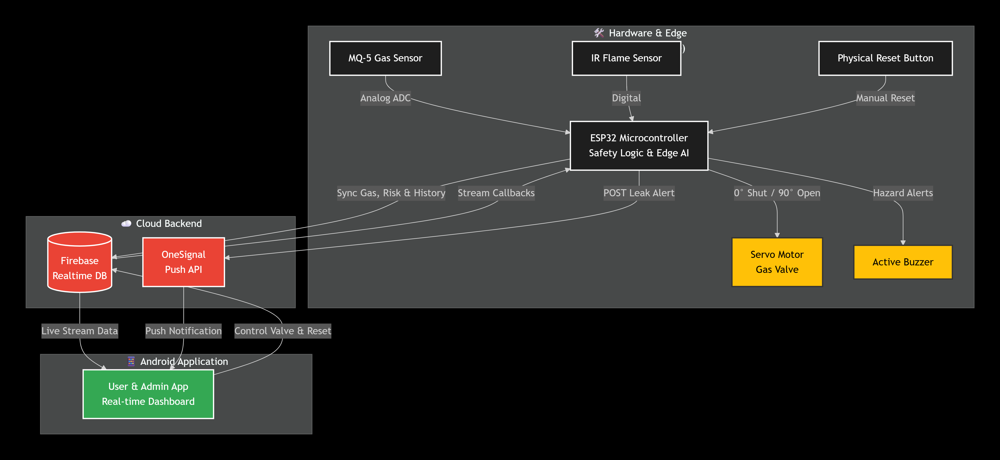
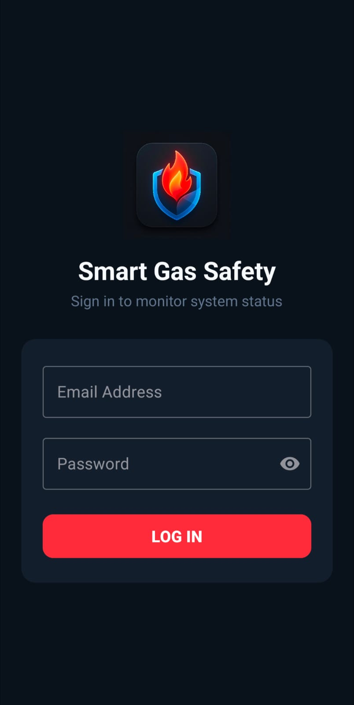
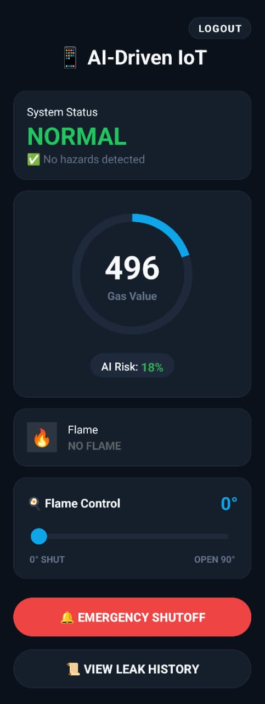
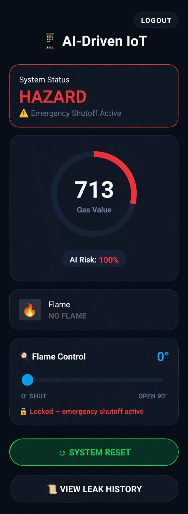
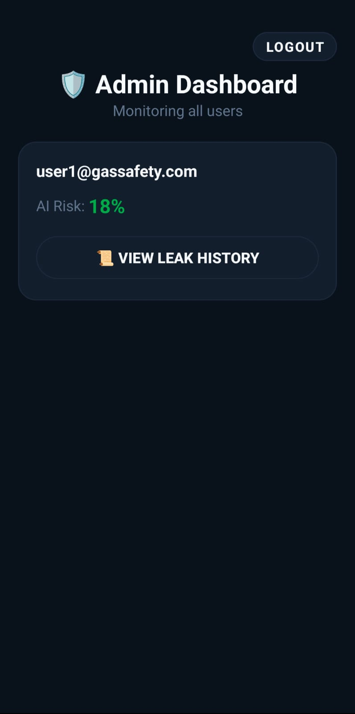

# 🛡️ Smart Gas Safety System (IoT & Android)

An end-to-end IoT safety solution designed to detect hazardous gas leaks and fires, automatically shut off the gas valve, and provide real-time alerts to homeowners and monitoring admins. 

This repository contains the complete ESP32 firmware and the Android application (Java), built as an end-to-end independent engineering project.

## ✨ Key Features

*   **Autonomous Safety Shutoff:** Detects hazardous gas levels (based on absolute thresholds and sudden spikes) or fire (IR sensor) and instantly closes the physical valve via a servo motor while sounding a local buzzer. This core safety loop runs entirely offline.
*   **Edge AI Risk Scoring:** Calculates a live danger percentage locally on the ESP32 using a weighted algorithm (70% gas proximity + 30% spike velocity) to predict hazards before they reach critical levels, giving the user early warnings on the app.
*   **Safety Latching:** Once an emergency is triggered, the valve remains mechanically shut until a human explicitly acknowledges the alert via the app or the physical reset button (preventing valve "chattering").
*   **Offline-Safe Event Queue:** If the Wi-Fi drops during a leak, the ESP32 logs the event locally (up to 5 events with NTP timestamps) and automatically pushes them to the cloud once the connection is restored.
*   **Targeted Push Notifications:** Utilizes OneSignal External IDs and Role tags (`house` and `role`) to ensure leak alerts only go to the specific homeowner and logged-in admins, preventing cross-user spam.
*   **Admin Monitoring Dashboard:** A dedicated Android activity allows admins to monitor live risk scores and leak history across multiple houses, strictly without accessing private gas or valve control data.

## 🏗️ System Architecture

1.  **Hardware Layer:** ESP32 reads analog gas levels (MQ-5) and digital flame signals (IR). It controls an MG996R servo (gas valve) and a local buzzer.
2.  **Cloud Layer:** Firebase Realtime Database acts as the bridge. Strict security rules ensure users only access their own nodes, while admins are restricted to reading `risk_score` and `leak_detected`.
3.  **Application Layer:** Android app (Java) uses Firebase listeners for real-time UI updates and OneSignal for push notifications. 
4.  **Firmware Logic:** Operates on a non-blocking loop. Safety logic runs entirely offline; cloud connections and telemetry syncing happen in the background.

## 🛠️ Hardware Requirements

*   **ESP32** Development Board
*   **MQ-5** Gas Sensor (Requires 5V power and a resistor divider for 3.3V ADC safety)
*   **IR Flame Sensor** (Active LOW)
*   **MG996R** Servo Motor (for physical valve control)
*   **Active Buzzer**
*   Push button (for manual reset)

## 💻 Software Stack

*   **Firmware:** C++ (Arduino IDE / PlatformIO) using `Firebase_ESP_Client` and `ESP32Servo`.
*   **Android App:** Java, Material Design, Firebase Auth, Firebase Realtime Database, OneSignal SDK.
*   **Cloud Services:** Firebase (Auth & RTDB) and OneSignal (REST API).

## 🚀 Setup & Installation

### 1. Firebase & OneSignal Configuration
*   Create a Firebase project and enable Email/Password Authentication and Realtime Database.
*   Publish the provided security rules (ensure admins cannot read `gas_value` or `servo_angle`).
*   Create a OneSignal app and generate a REST API Key.

### 2. Firmware (ESP32)
* Create a `secrets.h` file in the same directory as `main.cpp` with the following credentials:
  ```cpp
  #define WIFI_SSID "your_wifi"
  #define WIFI_PASSWORD "your_password"
  #define API_KEY "firebase_web_api_key"
  #define DATABASE_URL "your_firebase_db_url"
  #define USER_EMAIL "device_owner_email"
  #define USER_PASSWORD "device_owner_password"
  #define ONESIGNAL_API_KEY "your_onesignal_rest_key"
  #define ONESIGNAL_APP_ID "your_onesignal_app_id"
  ```
* Flash the code to the ESP32.

### 3. Android App
*   Add your `google-services.json` file to the `app/` directory.
*   Update the OneSignal App ID in `LoginActivity.java`.
*   Build and run the project in Android Studio.

## 📸 Project Gallery

### System Architecture


### Android Application
| Login | Dashboard | Emergency State | Admin Dashboard |
| :---: | :---: | :---: | :---: |
|  |  |  |  |

## 🔒 Security Note

The `secrets.h` and `google-services.json` files are intentionally **gitignored** in this repository to prevent credential leaks. If cloning this repository, you must provide your own credentials to compile the firmware or the Android app.

## 🚀 Future Roadmap
*   **Backend Migration:** Transition from Firebase Realtime Database to a custom Spring Boot (Java) REST API backend with PostgreSQL for enterprise scalability and vendor independence.
*   **Hardware Integration:** Replace the demo servo valve with an inline solenoid valve for a true commercial gas pipeline.
---
*Developed as a full-stack IoT engineering project.*
